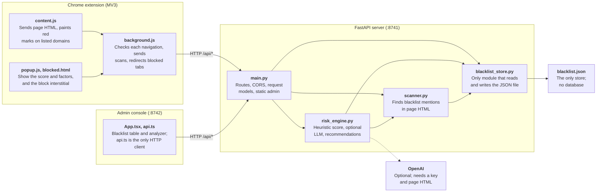

# Netrex project analysis

Oct 31, 2026 · @Jack

## Summary

Netrex is a well-structured hackathon prototype of about 2,200 lines that suits a guided demo but cannot yet be relied on for real protection. Its blocking can be bypassed, its scores mislabel well-known sites, and its API has no access control.

- **Structure:** the code matches its documentation. The server alone owns the blacklist and scoring, and the admin console and extension only call it over HTTP.
- **Setup:** installing the pinned Python dependencies failed on this machine's Python 3.14.7, so the README quick start does not work there as written.
- **Blocking:** only domains on the list are blocked. A high risk score never blocks anything.
- **Scoring:** `accounts.google.com` scores 50 (medium), while the lookalike `paypa1-login.com` scores 22 (low).
- **Security:** anyone who can reach port 8741 can edit the blacklist, and a built admin console exposes a path traversal that reads files outside its folder.
- **Evasion:** a URL containing `blocked.html` skips the block check, and one malformed link makes page scanning fail.
- **Brief:** the photographed project brief asks for analysis of emails and text messages, plus security reports. Neither exists yet.

## Purpose and scope

The README describes a hackathon project called AI Cybersecurity Guardian (the repository folder is named netrex). It makes three promises: block risky domains, highlight blacklisted URLs on pages, and score phishing risk for the current site.

The README's demo surfaces show the intended use:

| Surface | Demo moment |
| --- | --- |
| Admin console | Add or remove a domain; run the risk analyzer on a phishing-looking URL |
| Extension popup | Risk gauge, factors and recommendations on any tab |
| Navigation | Visiting a blacklisted host shows a full-page blocked interstitial |
| Content script | A page that mentions a blacklisted domain gets red highlights and outlined links |

## Architecture and code structure

Guardian is one FastAPI server with two HTTP clients, and all blacklist data sits in one JSON file.

*Guardian architecture · 2 clients, 1 server, 1 JSON file. Clients only call the API; only `blacklist_store` touches the file.*

Arrows show calls. Inside the extension, `content.js` and the popup message `background.js`, which makes the API calls.

A normal page visit runs in this order:

1. `background.js` posts the URL to `/api/check` when the navigation commits.
2. If the domain is listed, the tab is redirected to `blocked.html`.
3. Otherwise, `content.js` sends the page HTML through `background.js` to `/api/scan`.
4. `content.js` marks each returned domain in red and outlines links to it, then rescans after DOM changes with a 1.2-second debounce.
5. Deep analyze in the popup posts the page HTML to `/api/analyze`.

Scores start at 8, gain points for each signal and are capped at 100. The bands are safe below 20, low from 20, medium from 40, high from 65 and critical from 85. When the LLM runs, the higher of the two scores is kept, so it can raise a score but never lower it.

## Tech stack and how it runs

The project is three independently started pieces with no container or deployment setup; everything runs locally on two ports plus a browser extension.

| Piece | Stack | Started with | Address |
| --- | --- | --- | --- |
| `backend/` | Python, FastAPI 0.115.6, Uvicorn 0.34.0, Pydantic 2.10.4, BeautifulSoup 4.12.3, lxml 5.3.0, httpx 0.28.1 | `npm run api` from the root, or `uvicorn app.main:app` | `0.0.0.0:8741` |
| `admin/` | React 19, TypeScript 7, Vite 8, Tailwind 4, lucide-react, oxlint | `npm run admin`, or `npm run dev` in `admin/` | `0.0.0.0:8742` |
| `extension/` | Chrome Manifest V3, plain JavaScript, no build step | Load unpacked from `chrome://extensions` | Calls `http://127.0.0.1:8741` |

Storage is one JSON file, `backend/data/blacklist.json`. The only external service is OpenAI, used when `OPENAI_API_KEY` is set; the model defaults to `gpt-4o-mini` and can be changed with `OPENAI_MODEL`. `python-multipart` is pinned in `backend/requirements.txt`, but no route takes form data.

## Documentation and brief versus code

The architecture document is accurate about how the parts are separated; the gaps are in the README's details and in coverage of the original brief.

| Claim | Source | What the code does | Verdict |
| --- | --- | --- | --- |
| Dashboard and extension change state only through `/api/*` | `docs/ARCHITECTURE.md` | Both use HTTP clients only; `blacklist_store.py` is the only code that writes the file | Accurate |
| Blacklist changes apply without a restart | `docs/ARCHITECTURE.md` | The store re-reads the file on every lookup | Accurate |
| Quick start installs the backend | `README.md` | `pip install` failed building `lxml` and `pydantic-core` on Python 3.14.7; no Python version is stated | Fails here |
| "Blocks risky domains" | `README.md` | Blocks only listed domains; the score is not used to block | Narrower than stated |
| `DELETE /api/blacklist` | `README.md` | The route is `DELETE /api/blacklist/{domain}` | Wrong path |
| API table is the API surface | `README.md` | Omits `GET /api/stats` and `GET /demo/threat-page`, which `docs/ARCHITECTURE.md` lists | Incomplete |
| Admin analyzer uses the LLM when a key is set | Admin UI text, `docs/ARCHITECTURE.md` | The LLM also needs page HTML, and the admin form sends only a URL, so it never runs there | Wrong |

The repository name, netrex, appears in none of its files; every file says Guardian.

The project brief is a photo at `assets/b8ec63a9-0145-45d6-ac11-86ac5673e5a8.jpg`, and nothing in the repository references it.

| Brief feature | Status | Notes |
| --- | --- | --- |
| Analyze URLs | Built | Admin analyzer and extension popup |
| Analyze emails or text messages | Not built | No input accepts them; `/api/analyze` returns "Nothing to analyze" without a URL. Webmail is scanned only as a web page |
| Identify suspicious patterns and explain why | Built | Factors are listed for each score |
| Risk score and recommendations | Built | Popup and admin analyzer |
| Understandable security reports | Partial | On-screen results only, with no report or export |

## Quality, risks and gaps

The biggest risks are the open API and the block bypass; the repository also has no tests or CI to catch regressions in scoring or blocking.

Findings marked Tested were reproduced against a scratch copy of the backend. Findings marked Code come from reading the source only.

| Severity | Finding | Effect | Where | Evidence |
| --- | --- | --- | --- | --- |
| High | No authentication, `allow_origins=["*"]`, and binding to `0.0.0.0` | A request carrying a foreign `Origin` header deleted `bit.ly` from the blacklist | `backend/app/main.py:24`, `package.json` | Tested with curl |
| High | Path traversal in the admin file route | `GET /../../backend/requirements.txt` returned the file; `.env` or any other readable file is exposed the same way. Applies only once `admin/dist` exists | `backend/app/main.py:183` | Tested |
| High | Any URL containing `blocked.html` skips the check | `https://paypal-verify-account.net/?x=blocked.html` would load unblocked | `extension/background.js:110` | Code |
| High | Malformed links crash parsing | `<a href="http://[">` makes `/api/scan` and `/api/analyze` return 500, so a page can switch off its own highlighting and analysis | `backend/app/scanner.py:25` | Tested |
| High | Blocking fails open and happens late | The check runs after the navigation commits, and pages load normally if the API is down | `extension/background.js:96`, `extension/background.js:108` | Code |
| Medium | Real brand subdomains are flagged as impersonation | `accounts.google.com` and `support.microsoft.com` score 50; `mail.google.com` and `aws.amazon.com` score 36 | `backend/app/risk_engine.py:178` | Tested |
| Medium | Lookalike domains are missed | `paypa1-login.com` and `g00gle-account.help` score 22 (low); there is no fuzzy matching | `backend/app/risk_engine.py:178` | Tested |
| Medium | Regional brand domains are flagged | `amazon.co.uk` and `google.de` score 38 as "non-official" | `backend/app/risk_engine.py:189` | Tested |
| Medium | IP addresses count as deep subdomains | The demo page URL alone scores 65 (high), before any content is read | `backend/app/risk_engine.py:172` | Tested |
| Medium | Relative form actions read as other hosts | `<form action="search.php">` adds 18 points for submitting to host `search.php` | `backend/app/risk_engine.py:240` | Tested |
| Medium | Mentions are overcounted | One mention counts as 3 hits, which inflates the score | `backend/app/scanner.py:95` | Tested |
| Medium | Matching ignores domain boundaries | The text `rabbit.ly` matches the blacklisted `bit.ly` | `backend/app/scanner.py:100`, `extension/content.js:43` | Tested on the server |
| Medium | Blacklist input is barely validated | `example.com/some/path` is stored but can never match, and `co.uk` would block every `.co.uk` site | `backend/app/blacklist_store.py:72` | Tested |
| Medium | Full page HTML leaves the browser | Each page's HTML goes to the API on load and after DOM changes, including signed-in pages. It stays local unless the API address is changed. Deep analyze also sends up to 2,500 characters to OpenAI when a key is set | `extension/content.js:97`, `backend/app/risk_engine.py:93` | Code |
| Medium | Page text can steer the LLM result | Page text goes directly into the prompt, and the LLM summary replaces the shown one, even for blocked domains. The score can only rise | `backend/app/risk_engine.py:93`, `backend/app/risk_engine.py:303` | Code |
| Medium | Tab results live only in memory | Chrome can stop an MV3 service worker when idle, which would empty the popup until the next check | `extension/background.js:3` | Code |
| Medium | No way past a block | `bit.ly` and `tinyurl.com` are seeded with medium severity, yet every link through them gets the full block with no override. "Go back to safety" may also return to the blocked page and re-trigger it | `backend/data/blacklist.json`, `extension/blocked.js:9` | Code |
| Low | Iframes are not checked | The navigation check and the content script both cover only the top frame | `extension/background.js:109`, `extension/manifest.json` | Code |
| Low | Blacklist writes are not atomic | A crash during a write can leave the JSON file truncated | `backend/app/blacklist_store.py:37` | Code |
| Low | "API offline" status is overwritten | The popup pill changes to "unknown" straight away; the error text remains | `extension/popup.js:51`, `extension/popup.js:78` | Code |
| Low | Leftover code | A branch that only does `pass`, and an unused `python-multipart` dependency | `backend/app/risk_engine.py:184` | Code |

**What this analysis did not exercise:**

- **Pinned backend versions:** they would not install, so tests ran on current releases, including FastAPI 0.162.0 and Starlette 1.10.0. The cause of the build failure was not investigated further.
- **Extension:** it was not run in Chrome.
- **Admin console:** it was not built or linted, because `npm` is not installed on this machine.
- **OpenAI path:** it was not called, as no key was used.
- **Browser access to the API:** cross-origin behaviour was tested with curl. Chrome's local network protections may stop some website-initiated requests, but they do nothing for other machines reaching `0.0.0.0:8741`.
