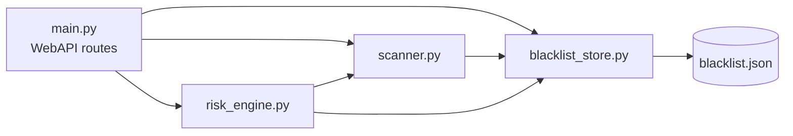
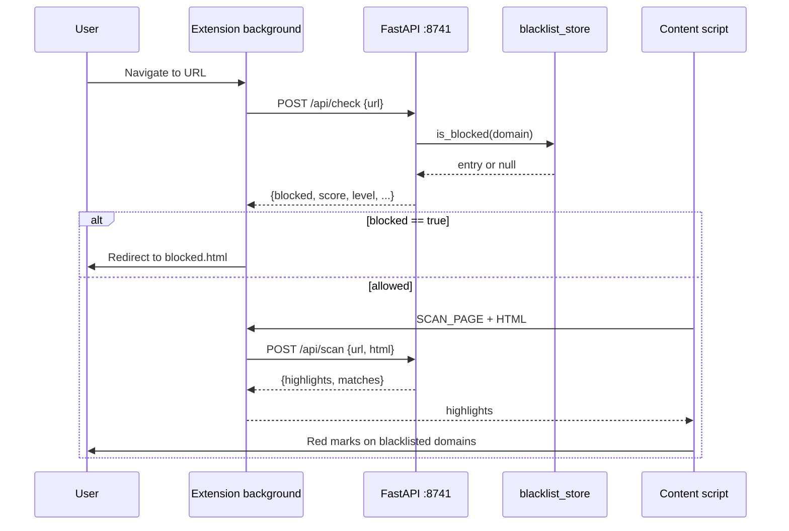
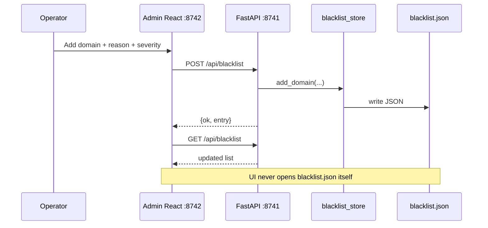
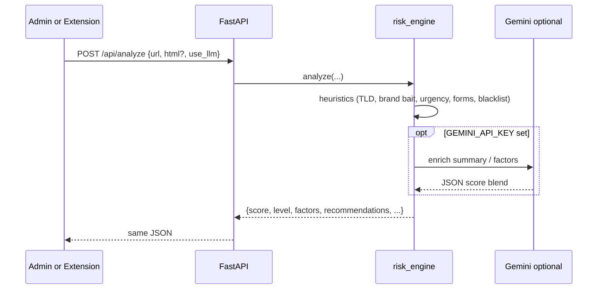

# Guardian architecture & modularity

This document explains how the project is split into modules, what talks to what, and whether the dashboard can change server state without going through the WebAPI.

**Short answer:** Yes — the Python server is a separate process and the only authority over `blacklist.json` and risk logic. The React dashboard and Chrome extension are pure clients. They never open the JSON file or call Python functions directly; every read/write goes through HTTP `/api/*` requests.

---

## 1. Three deployable pieces

| Piece | Runtime | Port (dev) | Role |
| --- | --- | --- | --- |
| **WebAPI server** (`backend/`) | FastAPI + Uvicorn | `8741` | Source of truth: blacklist, scan, risk score |
| **Admin dashboard** (`admin/`) | Vite + React | `8742` | Human UI to manage domains and preview scores |
| **Chrome extension** (`extension/`) | Browser MV3 | — | Protects the user while browsing |

```text
 ┌────────────────────┐     HTTP /api/*      ┌──────────────────────────┐
 │  Admin dashboard   │ ───────────────────► │                          │
 │  (React · :8742)   │                      │   FastAPI WebAPI :8741   │
 └────────────────────┘                      │                          │
                                             │   blacklist_store        │
 ┌────────────────────┐     HTTP /api/*      │   scanner                │
 │  Chrome extension  │ ───────────────────► │   risk_engine            │
 │  (MV3 client)      │                      │                          │
 └────────────────────┘                      └────────────┬─────────────┘
                                                          │
                                                          ▼
                                                 blacklist.json
```

Dev wiring: Vite proxies `/api` from `:8742` → `:8741` so the dashboard can call relative paths like `/api/blacklist` without CORS friction. The extension calls `http://127.0.0.1:8741` directly (configurable in Options).

Optional packaging: after `npm run build`, FastAPI can *serve* the built static files from `/`. That is only static hosting — the dashboard JS still mutates state exclusively via `/api/*`.

---

## 2. Is the server separate from the dashboard?

**Yes, in entirety for business logic.**

| Concern | Server owns it? | Dashboard owns it? |
| --- | --- | --- |
| Persist / update blacklist | Yes (`blacklist_store` → JSON) | No — only `POST` / `DELETE /api/blacklist` |
| Decide blocked / score | Yes (`risk_engine`, `scanner`) | No — only displays API JSON |
| UI layout, forms, gauges | No | Yes |
| Talk to Google Gemini | Yes (server-side key) | No |

So: **all changes to protected state happen through WebAPI requests.** If the dashboard is offline, the extension and API still work. If you replace the React app with another client (curl, Postman, a mobile UI), the server contract stays the same.

---

## 3. Module map

### Server-side (`backend/app/`)

| Module | Responsibility | Depends on |
| --- | --- | --- |
| `main.py` | HTTP boundary: routes, CORS, request models, optional static admin | store, scanner, risk_engine |
| `blacklist_store.py` | Thread-safe read/write of `data/blacklist.json`; normalize domains; parent-domain match | filesystem only |
| `scanner.py` | Parse HTML; find blacklist mentions; return highlight payloads | blacklist_store |
| `risk_engine.py` | Heuristic score (+ optional LLM); recommendations | blacklist_store, scanner, gemini |
| `ai_report.py` | Returns a page's saved report, or fills in `prompts/risk-scoring-prompt.md`, calls the model and computes the weighted risk score and report text | blacklist_store, scanner, gemini, report_store |
| `gemini.py` | Only module that calls the Google Gemini API | httpx |
| `report_store.py` | Thread-safe read/write of `data/reports.json`; saved reports stay until purged | filesystem only |

Internal call shape (no HTTP between these modules — plain Python imports):



### Client-side — admin (`admin/src/`)

| Module | Responsibility |
| --- | --- |
| `api.ts` | Sole HTTP client for `/api/*` |
| `App.tsx` | Screens: blacklist table, add/remove, analyzer form |
| `components.tsx` | Presentational: risk gauge, severity badge, panel |

### Client-side — extension (`extension/`)

| Module | Responsibility |
| --- | --- |
| `config.js` | API base URL from `chrome.storage` |
| `background.js` | Navigation hook, `/api/check`, `/api/scan`, `/api/analyze`, badge, block redirect |
| `content.js` | Sends page HTML; paints red highlights from scan results |
| `report-ui.js` | Starts the page's risk report; shows toasts and the report frame |
| `report.html` | Risk report frame: score, severity and description |
| `popup.js` | Shows score / factors from tab state; reopens the risk report |
| `blocked.html` | Interstitial when a domain is blacklisted |
| `options.js` | Change API base URL |

---

## 4. End-to-end flows

### A. Browse a site (extension → server)



### B. Operator changes the blacklist (dashboard → server)



After this write, the **next** extension `/api/check` or `/api/scan` sees the new domain — no restart required (store re-reads under a lock).

### C. Risk analyzer (dashboard or extension → server)



---

## 5. WebAPI surface (the contract)

All clients share this contract. Interactive docs: `http://127.0.0.1:8741/docs`

| Method | Path | Who uses it | Mutates state? |
| --- | --- | --- | --- |
| `GET` | `/api/health` | Admin, probes | No |
| `GET` | `/api/stats` | Admin | No |
| `GET` | `/api/blacklist` | Admin | No |
| `POST` | `/api/blacklist` | Admin | **Yes** — add/update domain |
| `DELETE` | `/api/blacklist/{domain}` | Admin | **Yes** — remove domain |
| `POST` | `/api/check` | Extension (every navigation) | No |
| `POST` | `/api/scan` | Extension (page HTML) | No |
| `POST` | `/api/analyze` | Admin analyzer, extension deep analyze | No |
| `POST` | `/api/report` | Extension (each page load) | **Yes** — saves the first report for a page |
| `GET` | `/api/reports` | Admin | No |
| `DELETE` | `/api/reports` | Admin | **Yes** — purge all saved reports |
| `DELETE` | `/api/reports/item?url=` | Admin | **Yes** — purge one saved report |

Demo-only: `GET /demo/threat-page` serves HTML with blacklisted domain strings so highlighting can be shown without visiting a live phishing host.

---

## 6. Modularity rules (why this shape)

1. **Single write path** — only `blacklist_store` and `report_store` touch disk; routes and clients go through them.
2. **Clients are replaceable** — anything that speaks HTTP can drive the system.
3. **Scoring is server-side** — keeps API keys and heuristics off the extension/dashboard bundle.
4. **Extension UI is thin** — background owns network; content/popup only render.
5. **No shared memory between dashboard and server** — process isolation by default (`8741` vs `8742`).

---

## 7. Directory cheat sheet

```text
backend/
  app/main.py              # WebAPI entry
  app/blacklist_store.py   # persistence module
  app/scanner.py           # HTML → highlights
  app/risk_engine.py       # score + recommendations
  data/blacklist.json      # durable store
admin/
  src/api.ts               # HTTP client only
  src/App.tsx              # dashboard UI
extension/
  background.js            # protection orchestration
  content.js               # page highlights
  popup.js / blocked.html  # user-facing surfaces
```

For a timed judge walkthrough of these modules in action, see [DEMO.md](./DEMO.md).
